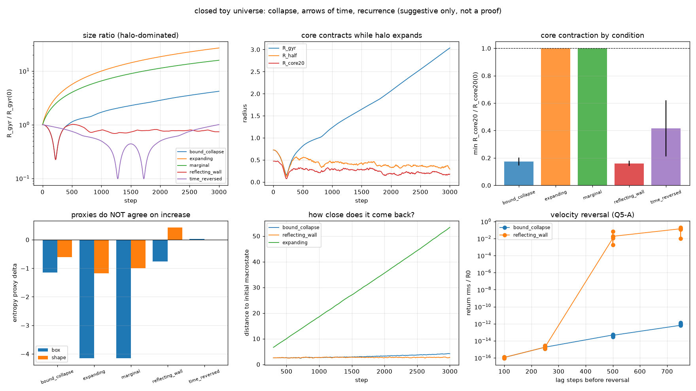
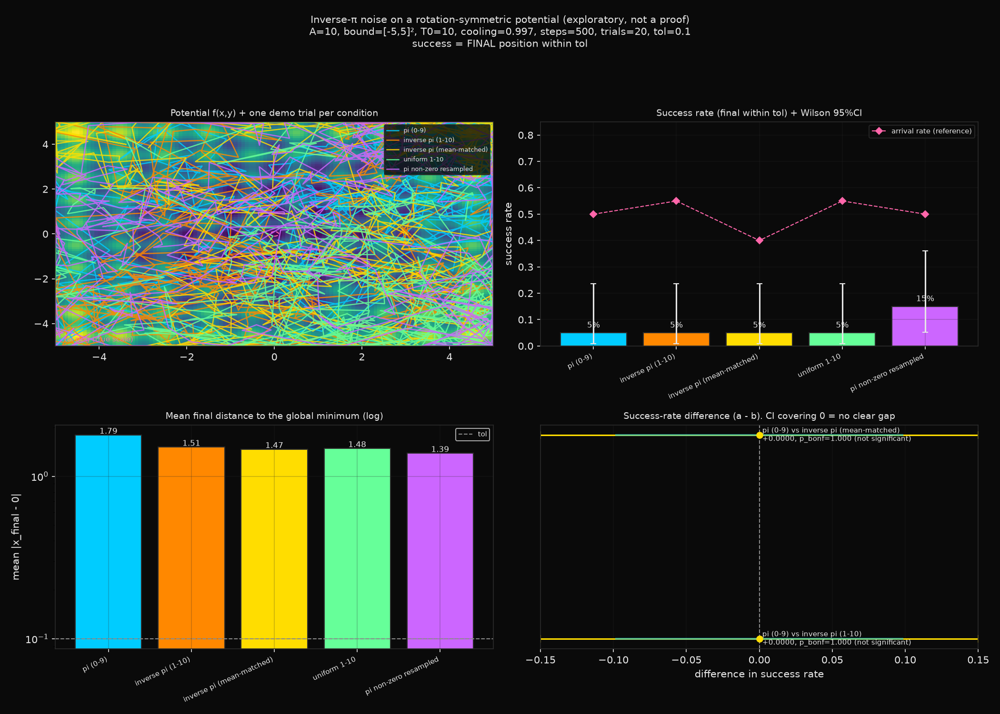
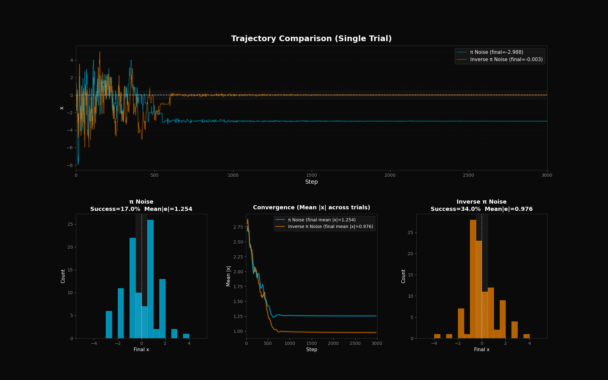

# Inverse Pi Optimizer (逆円周率オプティマイザー) 🌀

円周率（$\pi$）の各桁を「10の補数」に反転させた**逆円周率（Inverse $\pi$）**——
「ゼロ（完全な静止）を含まないノイズ」は、焼きなまし法（Simulated Annealing）の
局所解脱出に効くのか？を、**反証可能な形で**確かめる実験室です。

> **本リポジトリ**: 公開ミラー（`main`）。Zenn / BMC 導線は主にこちら。
> **開発正本**: [Labs/inverse-pi-optimizer @ ai-budget-meter](https://github.com/cocoa3j21/ai-budget-meter/tree/master/Labs/inverse-pi-optimizer)。
> 兄弟研究: [`cosmic_toy/`](cosmic_toy/) · [`rotation_minimal/`](rotation_minimal/)

> [!IMPORTANT]
> 2026-11-24 にマトリクス実験へ拡張し、**最初のCLAIM（逆π＝最強エネルギー）を
> 自分の手で検証し直しました**。結果は下記の実測どおり、
> 「逆πが強い」という前提はこの実験系では**ほぼ成立しません**。
> 代わりに「**歩幅と温度帯で振れが決まるノイズの話**」として読み替えるのが誠実です。

* 哲学的な背景の初出は下記 Zenn 記事です。
  - **§4** — 実測整合済: [`zenn_article_section_4_measured.md`](zenn_article_section_4_measured.md)
  - **§1–§2** — **公開反映済（2026-11-25）** — 正本: [`zenn_article_sections_1_2_editor_paste.md`](zenn_article_sections_1_2_editor_paste.md) · 索引 [`inverse_pi_article.md`](inverse_pi_article.md)
  - タイトル「…救う…」は**任意**で緩和可（URL 固定）
  [【Python】不可解な「逆円周率ノイズ」を、局所解からAIを救うアテにする](https://zenn.dev/cocoa3j21/articles/b72a764450e23a)

---

## 🌌 cosmic_toy（閉じた玩具宇宙）

逆πシリーズの派生として、**2 次元・重力のみの玩具宇宙**で凝縮・時間の矢・循環を数値追跡しています（**示唆・解釈実験**。宇宙論の証明ではありません）。

| 公開ミラー（本リポジトリ） | 開発正本（フルログ） |
| :--- | :--- |
| [`cosmic_toy/`](cosmic_toy/) — スクリプト・README・代表図・Zenn 草案 | [Labs/cosmic_toy](https://github.com/cocoa3j21/ai-budget-meter/tree/master/Labs/cosmic_toy) |

詳細: [`cosmic_toy/README.md`](cosmic_toy/README.md) · [Zenn（2fc28f602b0a6c）](https://zenn.dev/cocoa3j21/articles/2fc28f602b0a6c) · [`cosmic_article.md`](cosmic_toy/cosmic_article.md)



---

## 🔄 rotation_minimal（回転対称ポテンシャル）

**2D 回転対称ポテンシャル**上で 5 ノイズ条件の焼きなまし法を最小構成で比較（**示唆**のみ。最適化の一般定理や物理法則の確定ではありません）。

| 公開ミラー | 開発正本 |
| :--- | :--- |
| [`rotation_minimal/`](rotation_minimal/) | [Labs/rotation_minimal](https://github.com/cocoa3j21/ai-budget-meter/tree/master/Labs/rotation_minimal) |

詳細: [`rotation_minimal/README.md`](rotation_minimal/README.md) · [Zenn rotation（c04f92631055ed）](https://zenn.dev/cocoa3j21/articles/c04f92631055ed)



---

## ⚠️ 先に結論（2026-11-24 の実測・示唆どまり）

360 セル（5 ノイズ条件 × 6 目的関数 × 4 温度帯 × 3 冷却率）× 60 試行 = **21,600 試行**を
回した結果:

| 調べたこと | 実測 | 読み方 |
|---|---|---|
| π に対し逆πは成功率が高いか（72 グループ平均） | **-0.0016**（-0.16 ポイント） | 差はほぼゼロ。向きも逆 |
| 歩幅を揃えた統制条件 (mean-matched) は | **-0.0032** | 揃えても揃えなくても同じ程度 |
| セル内の典型差（中央値&#124;差&#124;） | 0.0167（60 試行中 1 試行分） | 噪声レベル |
| 864 本の比較のうち Bonferroni 補正後に p<0.05 | **0 本** | 「有意」Assert は出来ない |
| 同・未補正で p<0.05 | 49 本（成功率 2 / MAE 20 / 到達 27） | 864 本なら偽陽性の期待値≈43 本。補正で消える |
| 差の向きは温度帯で変わるか | **変わる**（下表） | 条件付きの話ならできる |

`rastrigin_1d` の成功率（cooling=0.997）を温度帯別に並べると、優劣が入れ替わります:

| T0 | π | inverse π | mean-matched | uniform 1-10 | π resampled |
|---|---|---|---|---|---|
| 5  | 0.567 | 0.567 | 0.500 | 0.450 | 0.533 |
| 15 | 0.150 | **0.283** | 0.267 | 0.250 | 0.283 |
| 25 | 0.267 | 0.183 | **0.300** | 0.333 | 0.233 |
| 40 | 0.117 | 0.217 | **0.283** | 0.150 | 0.217 |

→ 「逆πが効く／効かない」の二者択一ではなく、**どの温度帯で見るか**で向きが変わる。
　　平均すると差は消える。これが今の正直な着地点です。

---

## 🚀 収録スクリプト

| ファイル | 役割 | 状態 |
|---|---|---|
| [`anti_circle_optimizer.py`](anti_circle_optimizer.py) | **マトリクス実験本体**（SA・統計・可視化） | 2026-11-24 拡張 |
| [`anti_circle_generator.py`](anti_circle_generator.py) | π / 逆π のランダムウォーク軌跡を描画 | 変更なし |
| [`irrational_engine.py`](irrational_engine.py) | 無理数ベースのサンプリング実験 | 変更なし |
| [`irrational_sampler.py`](irrational_sampler.py) | 同上のサンプラ | 変更なし |
| [`EXPERIMENT_PLAN.md`](EXPERIMENT_PLAN.md) | 本実験の事前計画（仮説・判定基準） | 追加 |
| `anti_circle_optimizer_legacy.py.bak` | 拡張前の旧版（2条件・単一温度） | 参考保存 |

---

## 🧪 実験デザイン

### ノイズ条件（摂動源）

| 条件 | 値域 | 平均歩幅（桁） | ゼロステップ率 | 意図 |
|---|---|---|---|---|
| `pi` | 0〜9 | 4.489 | **9.68%** | 対称ノイズの基準。約1割が完全停止 |
| `inverse_pi` | 1〜10 | 5.511 | 0% | 主役。0を含まないが歩幅も大きい |
| `inverse_pi_mean_matched` | 0.90〜9.02 | 4.971 | 0% | **統制①**「動いた時の歩幅」を π 非ゼロ平均に合わせる |
| `uniform_nonzero` | 1〜10 | 5.466 | 0% | 0を含まない乱数の対照（分布効果の切り分け） |
| `pi_nonzero_resampled` | 1〜9 | 4.967 | 0% | πの0だけ埋めた対照（分布を保ち0を消す） |
| `inverse_pi_width_matched` *（任意）* | 0.81〜8.15 | 4.489 | 0% | **統制②** 停止分込みの総平均歩幅を π に合わせる |

* 統制①は「1回の移動量」を揃えますが、π 側の 10% 停止を引いた**総移動量までは揃いません**（4.971 > 4.489）。
  そこで総移動量まで揃えた統制②も用意し、`--with-width-matched` で 6 条件目として追加できます（既定のマトリクスは 5 条件のまま）。

### 目的関数（すべて大域最適解が既知）

| 関数 | 次元 | 大域最適解 | 探索範囲 | 形状の意図 |
|---|---|---|---|---|
| `rastrigin_1d` | 1 | x=0 | ±4 | 等間隔の多峰性（既存の主ベンチマーク） |
| `rastrigin_2d` | 2 | (0,0) | ±4 | 多峰性の次元上げ |
| `ackley` | 2 | (0,0) | ±4 | 広い平坦部＋鋭い大域最小 |
| `griewank` | 2 | (0,0) | ±6 | 緩い二次項＋周期谷（勾配が薄い） |
| `rosenbrock` | 2 | (1,1) | ±3 | 狭いバナナ谷（方向の整合が必要） |
| `sphere` | 2 | (0,0) | ±5 | 単一谷の基準線（全条件 100% = ハーネスの健全性確認） |

### SA と判定

* 温度: `T0 ∈ {5, 15, 25, 40}`、冷却率 `∈ {0.995, 0.997, 0.999}`、ステップ数 3000、`step_scale=0.35`
* 提案幅: `|step| = digit × step_scale × (T/T0 + 0.01)`、方向は 1D は ±1、多次元は正規乱数を正規化
* **success（主指標）**: *最終位置*が大域最適解から `tol=0.5` 以内 ← 旧版と同じ定義
* **arrival（参考）**: 一度でも `tol` 内に入ったか。低次元ではほぼ 100% に飽和するので主指標にしない
* 受理率の分母は「実際に提案が行われたステップ数」（digit=0 の停止は受理 also 拒否でもない）

### 乱数の方針（疑似ペア化の回避）

* `SeedSequence(entropy=42, spawn_key=(目的関数, T0, 冷却率, ノイズ条件))` で**セルごとに独立ストリーム**
* 旧版のような「条件をまたいだ `np.random.seed(SEED + trial)` の再利用」はしていません
  （同一シード再利用は試行を人工的にペア化し、対応あり検定の前提を偽装するため）
* そのため比較はすべて**非対応 (unpaired)** 検定: 置換検定 / Welch / Mann-Whitney

---

## 🛠️ 実行方法

```bash
# 依存（mpmath が無くてもフォールバックで動きます）
pip install numpy matplotlib mpmath

# マトリクス実験（360 セル・約 1 分・results/ と figures/ を生成）
python anti_circle_optimizer.py

# 開発用の軽い確認（12 試行 × 1000 ステップ）
python anti_circle_optimizer.py --quick

# 主なオプション
python anti_circle_optimizer.py --trials 120        # 試行数を増やして精度向上
python anti_circle_optimizer.py --steps 5000        # ステップ数変更
python anti_circle_optimizer.py --seed 7            # entropy 変更（再現は同じ値で）
python anti_circle_optimizer.py --with-width-matched  # 統制②を足して 6 条件に
python anti_circle_optimizer.py --no-figures        # PNG だけskip
python anti_circle_optimizer.py --legacy            # 旧版相当の単発比較のみ
```

動作環境（実測）: Python 3.14.3 / numpy 2.5.2 / matplotlib 3.11.2 / mpmath 1.4.1。
フル実行はマトリクス部が約 60 秒（実測 61.6〜62.2 秒）、検定＋図込みで 2〜3 分、
出力は 21,600 試行分です。同じコマンド・同じ `--seed` なら CSV は**バイト一致で再現**します
（2 回実行して MD5 一致を確認済み）。

---

## 📁 出力物とその見方

### `results/`

| ファイル | 中身 |
|---|---|
| `optimization_results.csv` | 試行ごとの生データ（21,600 行）。`success` / `arrival` / `first_arrival_step` / `mae` / `final_distance` / `final_value` / `accept_rate` / `spawn_key` |
| `optimization_summary.csv` | セル（360 行）の統計。成功率＋**Wilson 95%CI**、平均/中央絶対誤差、平均受理率、ゼロステップ率、平均/最大ステップ幅、到達ステップ数の中央値 |
| `comparisons.csv` | 事前登録 4 ペア × 3 指標 × 72 グループ = **864 行**。リスク差（Newcombe CI）、オッズ比（CI）、p 値（置換検定/Welch/Mann-Whitney）、効果量（risk_diff / Hedges' g / rank-biserial）、`p_bonferroni_family` と `p_bonferroni_global`、そして自動生成の `note` |
| `final_position_histogram.csv` | 最終位置（最適解からの距離）のヒストグラムビン |
| `optimization_results.json` | 設定・ノイズ統計・全セル統計・基準セル・集計・仮説要約 (`hypothesis_summary`)・`step_width_verdict`・`interpretation_notes` |

読み方の順: **まず `optimization_summary.csv` の `success_rate_ci_lo/hi` を見て、
区間が重なっている差は差として扱わない**。次に `comparisons.csv` の
`p_bonferroni_global`（864 本で補正後）を確認し、`note` 列が
「補正後も差が残る」と書いていないかを拾う——今の結果では 0 本です。

### `figures/`

| 図 | 見るポイント |
|---|---|
| `success_rate_comparison.png` | 温度帯ごとの成功率ヒートマップ。**列間で色が揃っていれば差が無い**、行（関数）で模様が変われば形状依存 |
| `step_distribution_comparison.png` | 歩幅そのもの。mean-matched が π 非ゼロ平均に寄っていること、π だけゼロステップが約1割あることを確認 |
| `convergence_comparison.png` | 「これまでで最良の距離」の曲線。終盤で束縛されていれば差は小さい |
| `escape_time_comparison.png` | 到達ステップ数と、T0 に対する成功率の線（**交差＝条件依存**） |
| `optimization_escape.png` | 代表 1 試行の軌跡。**これは絵であり証拠ではない**ので図中で "illustration, not evidence" と明記。凡例の `arrival=N` は「N ステップ目で初めて tol 内に入った」の意味で、**そこから出てまた戻っていない場合**（最終成否とは別）があるので混同しないこと |

---

## 🧭 現時点で言えること／言えないこと

### 言える（実測の範囲）

* π ノイズでは **9.68%** のステップが `digit=0` で完全に停止する（1万桁ベース。
  実験で実際に使う先頭 3000 桁では **8.6%**。図 `step_distribution_comparison.png` は後者）。
* 逆πは 0 を含まないが、**平均歩幅も π より大きい**（5.51 vs 4.49）。
  つまり「0 の有無」と「歩幅の大きさ」は元々から混ざっている。
* その歩幅を揃えても（mean-matched）、**成功率の平均差はほぼ同じ大きさ**
  （π 比で -0.0016 → -0.0032）。差そのものが小さいので「説明率」は出していません。
* **温度帯によって優劣の向きが入れ替わる**（上の表）:
  T0=15 と T0=40 では逆π系が π を上回り（0.283 vs 0.150 / 0.283 vs 0.117）、
  T0=25 では逆に π (0.267) が逆π (0.183) を上回ります。
  単一の結論に潰せない、一番再現性のある観察です。
* `sphere` では全条件 100%。**ハーネス（目的関数・距離・受理）が壊れていないことの確認**になっています。

### 言えない（だから書かない）

* 「逆πは焼きなましを強くする」——**この実験系では平均的に差がありません**。
* 「円の不完全性／宇宙の非対称性が AI を救う」——観測量と繋がっていないので断定しません。
* 「0 であること自体が害」——`pi_nonzero_resampled`（0だけ消した対照）も
  π と同じ程度（0.308 vs 0.297）で、**0 を消しても劇的な改善は無い**結果。
* 機構の説明——本実験は 1セル 60 試行の探索段階で、効果量の大きさより向きを見る用途です。

### 既知の限界

1. 全条件が**同じ π 桁列**を共有しているため、桁列固有の偏りは相関して残ります。
2. `tol=0.5` 全関数一律。`griewank` / `ackley` は勾配が薄く成功率が総じて低く（〜0-0.15）、
   その分この 2 関数での判別力は弱いです。
3. 2 次元まで・単一の `step_scale=0.35`。高次元や歩幅スキャンでは結論が変わり得ます。
4. 同一シード系列を避けた代わりに試行は非対応なので、**セルあたりの検定力は 60 試行分しかありません**。
   温度帯の反転を追うなら `--trials 200` 前後での再実行が次の一手です。

---

## 🔁 再現性

* `SEED=42` 固定。同じコマンドなら**同じ CSV / 同じ図**が出ます（乱数は spawn_key 経由）。
  公開ミラー（cocoa3j21/inverse-pi-optimizer）側で再実行して SHA-256 を突き合わせた結果、
  `results/` + `figures/` の10ファイルのうち 9ファイルが一致し、唯一の差は JSON の
  `meta.elapsed_seconds`（実行時間の記録）のみでした（実験値の差分はゼロ）。
* `optimization_results.json` の `meta.params` に全設定（成功判定・受理率の定義・RNG 方針）が入っています。
* `results/` と `figures/` は生成物です。リポジトリの `.gitignore` が `*.png` を除外しているため、
  図はコミットされません（再生成してください）。

---

## 📌 従来の可視化（そのままで維持）

`anti_circle_generator.py` が作る π / 逆π のランダムウォーク軌跡（ルート画像）:


拡張前の 2 条件比較（旧版の絵、`anti_circle_optimizer_legacy.py.bak` 相当）:



## ☕ Support

もしこの「天才的な技術の無駄遣い（思考実験）」を楽しんでいただけたら、深夜のコーディングの励みになるカフェ代を支援していただけると嬉しいです！
[Buy cocoa3j21 a coffee ☕](https://www.buymeacoffee.com/cocoa3j21)

リポジトリ: [github.com/cocoa3j21/inverse-pi-optimizer](https://github.com/cocoa3j21/inverse-pi-optimizer)

## 📜 License

MIT License

