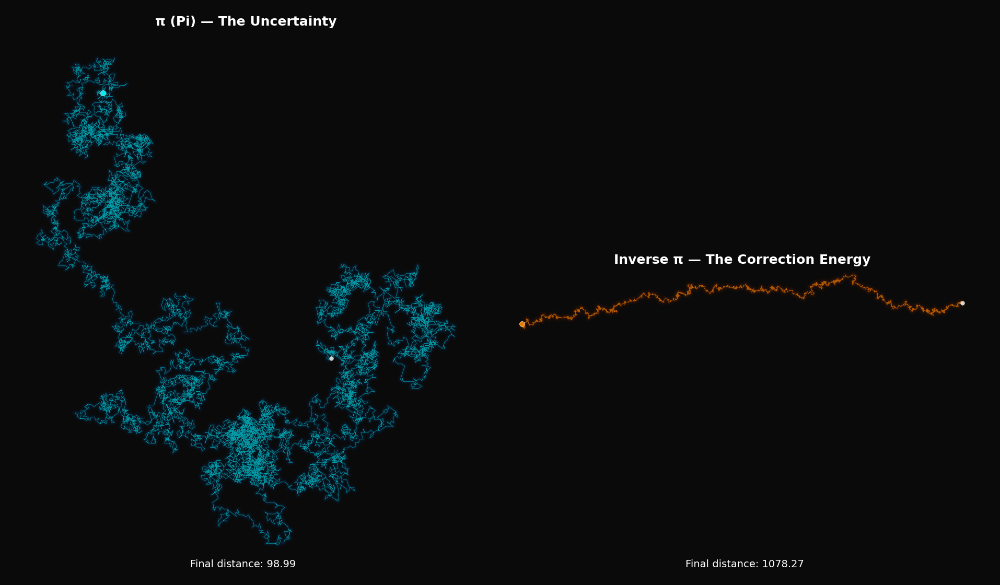

# Inverse Pi Optimizer (逆円周率オプティマイザー) 🌀

円周率 $\pi$ の各桁を「10の補数」に反転させた「逆円周率（Inverse $\pi$）」の概念を用い、「**ゼロ（完全な静止）が存在しない非対称ノイズ**」が、最適化アルゴリズム（Simulated Annealing）における局所解（ローカルミニマ）からの脱出にいかに寄与するかを検証するシミュレーションプロジェクトです。

## 📖 詳しい解説 (Zenn Article)

本プロジェクトの哲学的な背景とアルゴリズムの解説は、以下のZenn記事をご覧ください。

[【Python】不可解な「逆円周率ノイズ」を、局所解からAIを救うアテにする](https://zenn.dev/cocoa3j21/articles/b72a764450e23a)

---

## 🚀 収録スクリプトと実行結果

### 1. 軌跡のシミュレーション (`anti_circle_generator.py`)

円周率（0〜9）と逆円周率（1〜10）を極座標の角度ベクトルとしてランダムウォークさせた軌跡を描画します。0が存在しないことによる強力なドリフト（推進力）を視覚化します。



### 2. 最適化アルゴリズムの比較 (`anti_circle_optimizer.py`)

多数のローカルミニマを持つ関数に対し、対称ノイズ（ $\pi$ ）と非対称ノイズ（逆 $\pi$ ）および後述の対照条件を用いた焼きなまし法（SA）を実行し、大域的最適解への到達率を比較します。


---

## 🔬 対照実験（切り分け実験）

このディレクトリは、`anti_circle_optimizer.py` による「逆円周率（逆π）ノイズの局所解脱出効果」を、
「0がない非対称性」と「平均ステップ幅の大きさ」に切り分けて検証する実験の記録です。

## 1. 何を比較したのか

既存の比較では、πノイズ（桁0〜9）と逆πノイズ（桁1〜10）を単純に比較していました。しかし逆πは「0がない」だけでなく、
**平均ステップ幅が約22%大きい** ため、単純な比較では「非対称性の効果」と「探索幅増大の効果」を分離できません。

本実験では、以下の5つのノイズ条件を焼きなまし法（Simulated Annealing, 1D Rastrigin）で比較します。

| 条件 | 内容 | 役割 |
|------|------|------|
| π | 桁0〜9、0のときステップ0 | 基準（対称ノイズ） |
| 逆π | 桁1〜10、0なし | 既存の逆πノイズ |
| 逆π_平均補正 | 逆πをπの非ゼロ桁平均と平均ステップ幅を揃えた版（0なし） | **平均ステップ幅を統制した逆π** |
| 一様1-10 | 1〜10の一様整数ノイズ（桁列構造なし） | 逆πの桁列構造の有無を確認 |
| π_0除去 | πから0を除いた非ゼロ桁のみ再利用 | 「0を除いただけ」の補助条件 |

## 2. なぜ平均ステップ幅の補正が必要なのか

逆πノイズは「0がない」だけでなく、平均ステップ幅が大きいため、単純な π vs 逆π 比較だけでは、
「非対称性の効果」と「単なるステップ幅増大の効果」を分離できません。

`逆π_平均補正` は、逆πの各桁に `scale = πの非ゼロ平均 / 逆πの平均` を掛けて平均ステップ幅をπの非ゼロ平均と揃えたものです。
もし `逆π` と `逆π_平均補正` に成功率の差がほとんどなければ、差は「ステップ幅増大」によるものであり「非対称性」由来ではない可能性が高いと解釈できます。

## 3. 各条件の意味

- **π**: 0ステップ（完全停止）が約10%発生する対称ノイズ。基準。
- **逆π**: 0ステップなし、平均ステップ幅が大きい非対称ノイズ。既存の主張の対象。
- **逆π_平均補正**: 逆πと同じ「0なし・非対称」だが、平均ステップ幅をπと揃えた対照条件。
- **一様1-10**: 逆πと同じ値域・ほぼ同じ平均だが、πの桁列構造を持たない。桁列構造そのものに意味があるかを確認。
- **π_0除去**: πから0を除いただけ。平均ステップ幅はπより大きくなる。「0を除く」効果の補助。

## 4. 結果の見方

- `results/optimization_summary.csv`: 各条件の成功率（95% Wilson信頼区間付き）、平均/中央絶対誤差、平均受理率、ゼロステップ率、平均/最大ステップ幅、大域最適解到達ステップ数。
- `results/optimization_results.csv`: 各試行×各条件の詳細。
- `results/optimization_results.json`: 上記をJSON形式。
- `figures/*.png`: 成功率比較、ステップ幅分布、収束曲線、到達ステップ数、代表軌跡+最終位置分布。

条件間比較では、リスク差、オッズ比、p値（McNemar・permutation test）、コーエンh（効果量）を出力します。
「有意」と断定せず、p値と信頼区間を提示することで、因果断定を避けます。

## 4-1. 主要な結果の要約（n=1000 / ステップ3000 / 1D Rastrigin）

成功率（\|x\| < 0.5）の比較結果は以下のとおりです。p値は McNemar検定（ペア配置）と permutation test の両方を併記します。

| 比較 | リスク差 | 95%CI | p(McNemar) | p(permutation) | コーエン h |
|------|----------|-------|------------|----------------|------------|
| π vs 逆π | **+2.80 点** | [-1.04, +6.64] | **0.168** | **0.141** | 0.064 |
| 逆π vs 逆π_平均補正 | **+0.50 点** | [-3.26, +4.26] | **0.838** | 0.763 | 0.012 |
| 逆π vs 一様1-10 | **-0.70 点** | [-4.49, +3.09] | **0.755** | 0.674 | -0.016 |

各条件の成功率（点推定と95% Wilson信頼区間）:

| 条件 | 成功率 | 95% Wilson CI | 平均ステップ幅 | ゼロステップ率 |
|------|--------|---------------|----------------|----------------|
| π | 27.40% | [24.73, 30.25] | 0.101635 | 62.95% |
| 逆π | 24.60% | [22.03, 27.36] | 0.122034 | 62.28% |
| 逆π_平均補正 | 24.10% | [21.55, 26.85] | 0.112335 | 59.29% |
| 一様1-10 | 25.30% | [22.70, 28.09] | 0.121321 | 62.42% |
| π_0除去 | 23.80% | [21.26, 26.54] | 0.111354 | 59.29% |

**この設定で確認できた傾向（示唆）:**

1. **逆π vs 逆π_平均補正 の差は +0.50 点（p=0.838）で、ほぼ消滅します。** 平均ステップ幅を揃えると逆πの優位性が失われることは、π→逆πで見られた差の大半が「ステップ幅の大きさ」で説明できる可能性を示しています。
2. **逆π vs 一様1-10 の差は -0.70 点（p=0.755）。** π由来の桁列構造そのものより、値域1〜10の非ゼロノイズという点が効いている可能性を示します。
3. 本設定では π が逆π よりも成功率が高い結果となりました。πノイズのゼロステップが「局所解に留まる」働きをしている可能性もあり、単純に「静止＝悪」とは言えません。
4. 4つの比較すべてで 95%CI は 0 を含んでおり、成功率の差は統計的に曖昧です。

**結論（示唆であり断定ではありません）:**

> 逆πの効果は、非対称性そのものよりも、**平均ステップ幅の増大による可能性が高い** ことが示唆されました。
> ただし本実験の各比較は 95%信頼区間が 0 を含んでおり、「非対称性に効果がある」とも「完全に無効果」とも断定はできません。
> 「ゼロステップを排除した桁列ノイズは、焼きなまし法の局所解脱出に何らかの影響を与えるかもしれない。しかし、その効果が非対称性由来か、単なるステップ幅増大由来かは、平均補正対照実験で検証する必要がある。」

## 5. 現時点で言えること・言えないこと

### 言えること
- 逆πノイズは「0がない」だけでなく、平均ステップ幅も大きい。
- `逆π_平均補正` により、平均ステップ幅を統制した逆πをπと同等の平均幅で比較できる。
- 各条件の成功率・誤差・ステップ統計を定量的に比較できる。

### 言えないこと（現時点）
- 「非対称性こそが局所解脱出効果の正体である」と因果断定することはできない。
- `逆π` と `逆π_平均補正` の差が有意であっても、それが「非対称性」由来か「その他の要因」由来かは、この実験だけでは断定できない。
- Zenn記事のような哲学的・宇宙論的主張（「宇宙の非対称性がAIを救う」等）は、本実験では裏付けられていない。

## 6. Zenn記事のトーンについて

本実験は「示唆」として扱い、因果断定は避けます。

> 「ゼロステップを排除した桁列ノイズは、焼きなまし法の局所解脱出に何らかの影響を与えるかもしれない。
> しかし、その効果が非対称性由来か、単なるステップ幅増大由来かは、平均補正対照実験で検証する必要がある。」

「宇宙の非対称性がAIを救う」のような断定は避け、誠実で面白いトーンを保ちます。

## 7. 関連リンク・導線

- **Zenn記事（本実験の解説）**: [【Python】不可解な「逆円周率ノイズ」を、局所解からAIを救うアテにする](https://zenn.dev/cocoa3j21/articles/b72a764450e23a)
- **Buy Me a Coffee**: [Buy cocoa3j21 a coffee ☕](https://www.buymeacoffee.com/cocoa3j21)
- **GitHub（作者）**: [cocoa3j21](https://github.com/cocoa3j21)
- **GitHub（本リポジトリ）**: [cocoa3j21/inverse-pi-optimizer](https://github.com/cocoa3j21/inverse-pi-optimizer)

---

## 🛠️ 環境構築と実行方法

```bash
# リポジトリのクローン
git clone https://github.com/cocoa3j21/inverse-pi-optimizer.git
cd inverse-pi-optimizer

# 依存ライブラリのインストール
pip install mpmath numpy matplotlib

# スクリプトの実行
python anti_circle_generator.py
python anti_circle_optimizer.py
```

`python anti_circle_optimizer.py` を実行すると、`results/` と `figures/` にCSV/JSON/PNGが出力されます。
mpmath は未インストールでもハードコード済みのπ 1000桁フォールバックで動作します（乱数シード固定のため結果は再現可能です）。

---

## ☕ Support

もしこの「天才的な技術の無駄遣い（思考実験）」を楽しんでいただけたら、深夜のコーディングの励みになるカフェ代を支援していただけると嬉しいです！

[Buy cocoa3j21 a coffee ☕](https://www.buymeacoffee.com/cocoa3j21)

---

## 👤 作者

[GitHub: cocoa3j21](https://github.com/cocoa3j21)

---

## 📜 License

MIT License