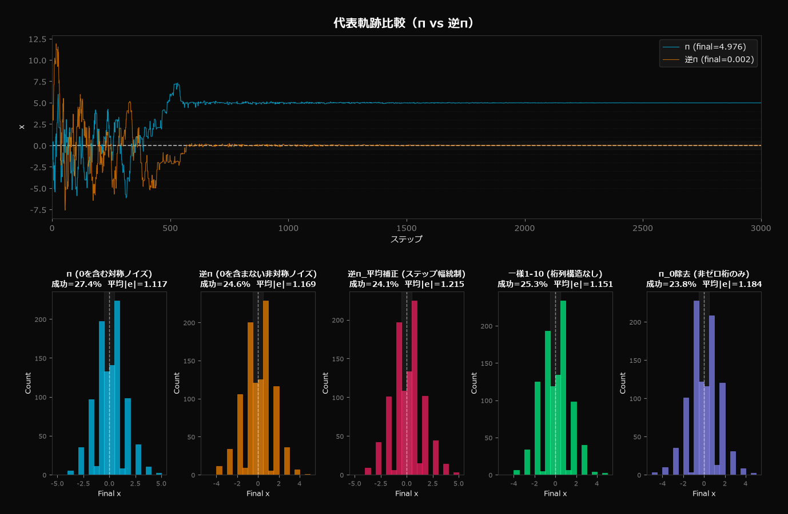
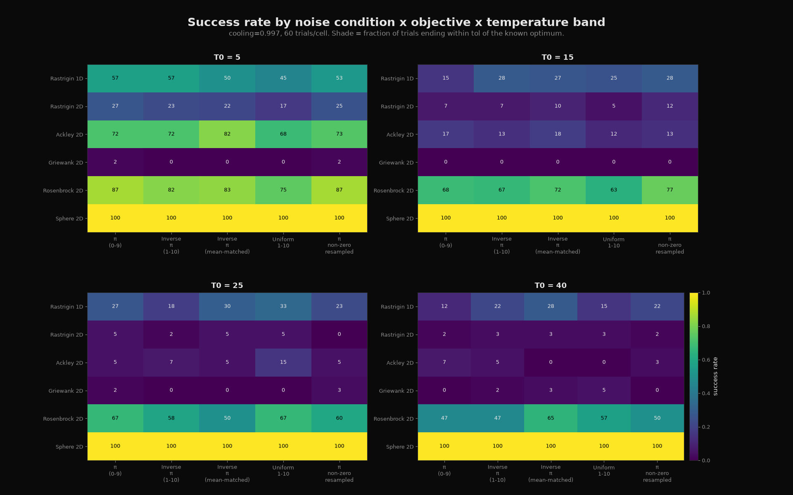
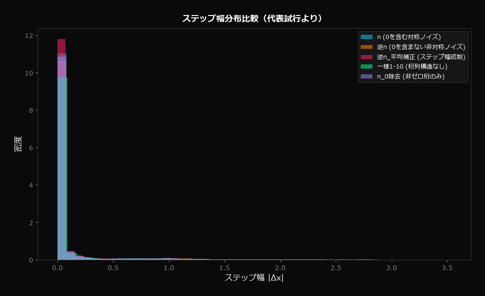
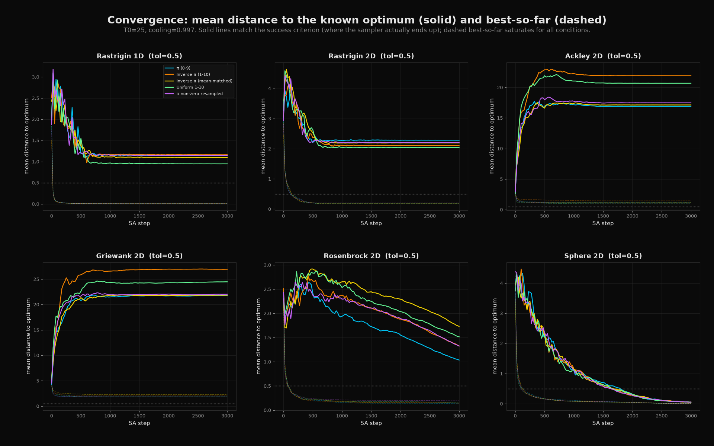
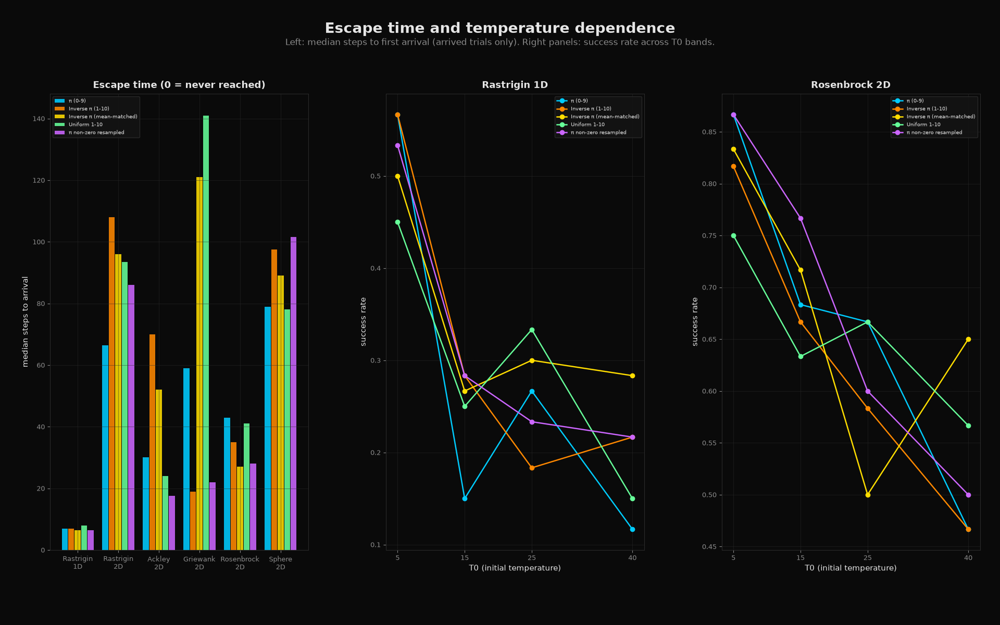

# Inverse Pi Optimizer (逆円周率オプティマイザー) 🌀

円周率 $\pi$ の各桁を「10の補数」に反転させた「逆円周率（Inverse $\pi$）」の概念を用い、「**ゼロ（完全な静止）が存在しない非対称ノイズ**」が、最適化アルゴリズム（Simulated Annealing）における局所解（ローカルミニマ）からの脱出にいかに寄与するかを検証するシミュレーションプロジェクトです。

> [!IMPORTANT]
> 2026-11-24 に対照実験を**マトリクス化**して拡張し、以前の単一温度・単一目的関数の結果を置き換えました。
> 結論のトーンは「**示唆**」のままです。非対称性を賛美する方向ではなく、
> 「**歩幅と温度帯で振れが決まるノイズの話**」として読み替えるのが、今のデータに誠実な読み方です。
>
> 文書の関係:
> * [`EXPERIMENT_PLAN.md`](EXPERIMENT_PLAN.md) — マトリクス実験の**事前計画＋実施後の変更点と実測**（現行の主文書）
> * [`EXPERIMENT_DESIGN.md`](EXPERIMENT_DESIGN.md) — 旧・単一温度実験（n=1000 / 1D Rastrigin）の設計書。歴史的記録として残しています

## 📖 詳しい解説 (Zenn Article)

本プロジェクトの哲学的な背景とアルゴリズムの解説は、以下のZenn記事をご覧ください。

[【Python】不可解な「逆円周率ノイズ」を、局所解からAIを救うアテにする](https://zenn.dev/cocoa3j21/articles/b72a764450e23a)

---

## 🌌 cosmic_toy（閉じた玩具宇宙）

逆πシリーズの派生として、**2 次元・重力のみの玩具宇宙**で凝縮・時間の矢・循環を数値追跡しています。
結論は**示唆**のみ（宇宙論の証明ではありません）。

| 公開ミラー（本リポジトリ） | 開発正本（フルログ） |
| :--- | :--- |
| [`cosmic_toy/`](cosmic_toy/) — スクリプト・README・代表図 | [Labs/cosmic_toy @ ai-budget-meter](https://github.com/cocoa3j21/ai-budget-meter/tree/master/Labs/cosmic_toy) |

詳細・Q1–Q5 の実測サマリ: [`cosmic_toy/README.md`](cosmic_toy/README.md)


---

## 🔄 rotation_minimal（回転対称ポテンシャル）

逆πシリーズのサテライトとして、**2D 回転対称ポテンシャル**上で 5 ノイズ条件の焼きなまし法を最小構成で比較します。
結論は**示唆**のみ（最適化の一般定理や物理法則の確定ではありません）。

| 公開ミラー（本リポジトリ） | 開発正本 |
| :--- | :--- |
| [`rotation_minimal/`](rotation_minimal/) — スクリプト・README・代表図 | [Labs/rotation_minimal @ ai-budget-meter](https://github.com/cocoa3j21/ai-budget-meter/tree/master/Labs/rotation_minimal) |

詳細・復旧推定表: [`rotation_minimal/README.md`](rotation_minimal/README.md)


---

## 🚀 収録スクリプトと実行結果

### 1. 軌跡のシミュレーション (`anti_circle_generator.py`)

円周率（0〜9）と逆円周率（1〜10）を極座標の角度ベクトルとしてランダムウォークさせた軌跡を描画します。0が存在しないことによる強力なドリフト（推進力）を視覚化します。


### 2. 最適化アルゴリズムの比較 (`anti_circle_optimizer.py`)

多数のローカルミニマを持つ関数に対し、対称ノイズ（ $\pi$ ）と非対称ノイズ（逆 $\pi$ ）および後述の対照条件を用いた焼きなまし法（SA）を実行し、大域的最適解への到達率を比較します。



---

## 🔬 対照実験（切り分け実験）

このディレクトリは、`anti_circle_optimizer.py` による「逆円周率（逆π）ノイズの局所解脱出効果」を、
「0がない非対称性」と「平均ステップ幅の大きさ」に切り分けて検証する実験の記録です。

## 1. 何を比較したのか

既存の比較では、πノイズ（桁0〜9）と逆πノイズ（桁1〜10）を単純に比較していました。しかし逆πは「0がない」だけでなく、
**平均ステップ幅が約22%大きい** ため、単純な比較では「非対称性の効果」と「探索幅増大の効果」を分離できません。

本実験では、以下の5つのノイズ条件を、焼きなまし法（Simulated Annealing）の摂動源として
**マトリクス**で比較します。

> **5 ノイズ条件 × 6 目的関数 × 4 温度帯（T0=5/15/25/40）× 3 冷却率（0.995/0.997/0.999）**
> ＝ **360 セル × 60 試行 = 21,600 試行**（1セル 3000 ステップ、`step_scale=0.35`）

| 条件 | 内容 | 平均歩幅（桁） | ゼロステップ率 | 役割 |
|------|------|------|------|------|
| π | 桁0〜9、0のときステップ0 | 4.489 | **9.68%** | 基準（対称ノイズ） |
| 逆π | 桁1〜10、0なし | 5.511 | 0% | 既存の逆πノイズ |
| 逆π_平均補正 | 逆πに `scale` を掛け、**動いた時の歩幅**をπ非ゼロ平均に揃えた版（0なし） | 4.971 | 0% | **平均ステップ幅を統制した逆π** |
| 一様1-10 | 1〜10の一様整数ノイズ（桁列構造なし） | 5.466 | 0% | 逆πの桁列構造の有無を確認 |
| π_0除去 | πから0を除いた非ゼロ桁のみ再利用 | 4.967 | 0% | 「0を除いただけ」の補助条件 |
| 逆π_総歩幅補正 *（任意）* | 停止分込みの**総平均歩幅**をπに揃えた版 | 4.489 | 0% | `--with-width-matched` で追加（既定は5条件） |

目的関数は `rastrigin_1d / rastrigin_2d / ackley / griewank / rosenbrock / sphere` の6種で、
いずれも大域最適解が既知です。成功判定は全関数共通で
「**最終位置が大域最適解から `tol=0.5` 以内**」（旧版と同じ定義）。
「一度でも tol に入った」は `arrival` として別建てにしています（1Dではほぼ100%に飽和するため）。

## 2. なぜ平均ステップ幅の補正が必要なのか

逆πノイズは「0がない」だけでなく、平均ステップ幅が大きいため、単純な π vs 逆π 比較だけでは、
「非対称性の効果」と「単なるステップ幅増大の効果」を分離できません。

`逆π_平均補正` は、逆πの各桁に `scale = πの非ゼロ平均 / 逆πの平均` を掛けて平均ステップ幅をπの非ゼロ平均と揃えたものです。
もし `逆π` と `逆π_平均補正` に成功率の差がほとんどなければ、差は「ステップ幅増大」によるものであり「非対称性」由来ではない可能性が高いと解釈できます。

**ただし1種類の補正では統制しきれない**ことが、やってみて分かりました。

* π の**全ステップの**平均歩幅は `4.489`（1割がゼロステップなので引き下げられる）
* π の**動いた時だけ**の平均は `4.971`
* `逆π_平均補正` は後者に揃えるため、**総移動量は依然 π より大きい**（4.971 > 4.489）

そこで「停止分込みの総平均歩幅」を π に揃えた第2の統制条件（`逆π_総歩幅補正`）も用意しました。
この2つを比べることで、

| 問い | どの比較で見るか |
|------|------|
| 「1回の移動が大きい」ことが効いているのか | π vs 逆π_平均補正 |
| 「歩幅の総量」が効いているのか | π vs 逆π_総歩幅補正 |
| 「0による静止そのもの」が効いているのか | 逆π vs 逆π_平均補正、および π_0除去 vs π |

### 乱数と検定の設計変更（旧版から重要）

旧版は「条件をまたいで同じシードを再設定」して試行を揃えていましたが、これは**見かけのペア化**を生み、
対応あり検定（McNemar・符号反転）の前提を偽ります。現行版は
`SeedSequence(entropy=42, spawn_key=(目的関数, T0, 冷却率, ノイズ条件))` で**条件ごとに独立したストリーム**を導出し、
比較はすべて**非対応検定**（ラベル置換 / Welch / Mann-Whitney）に切り替えました。
同じコマンド・同じ `--seed` であれば CSV はバイト一致で再現します。

## 3. 各条件の意味

- **π**: 0ステップ（完全停止）が約10%発生する対称ノイズ。基準。
- **逆π**: 0ステップなし、平均ステップ幅が大きい非対称ノイズ。既存の主張の対象。
- **逆π_平均補正**: 逆πと同じ「0なし・非対称」だが、**動いた時の**歩幅をπ非ゼロ平均と揃えた対照条件。
- **一様1-10**: 逆πと同じ値域・ほぼ同じ平均だが、πの桁列構造を持たない。桁列構造そのものに意味があるかを確認。
- **π_0除去**: πから0を除いただけ。平均ステップ幅はπより大きくなる。「0を除く」効果の補助。
- **逆π_総歩幅補正**（任意）: 停止分込みの総平均歩幅をπに揃えた第2の統制。`--with-width-matched` で6条件目として追加。

## 4. 結果の見方

| ファイル | 中身 |
|------|------|
| `results/optimization_summary.csv` | **360セル**の統計。成功率＋95% Wilson信頼区間、平均/中央絶対誤差、`arrival_rate`、平均受理率、ゼロステップ率、平均/最大ステップ幅、到達ステップ数の中央値 |
| `results/optimization_results.csv` | **21,600試行**の生データ（`success` / `arrival` / `first_arrival_step` / `mae` / `final_distance` / `final_value` / `accept_rate` / `spawn_key`） |
| `results/comparisons.csv` | 事前登録4ペア × 3指標 × 72グループ = **864行**。リスク差（Newcombe CI）、オッズ比（CI）、p値、効果量、`p_bonferroni_family` / `p_bonferroni_global`、自動 `note` |
| `results/final_position_histogram.csv` | 最終位置（最適解からの距離）のヒストグラムビン |
| `results/optimization_results.json` | 設定・全セル統計・基準セル・集計・`hypothesis_summary`・`step_width_verdict`・`interpretation_notes` |
| `figures/*.png` | 成功率ヒートマップ、ステップ幅分布、収束曲線、到達ステップ数と温度依存、代表軌跡 |

比較の作り方は旧版から変えました。リスク差・オッズ比に加えて、
**非対応**のラベル置換検定（成功率）・Welch（平均絶対誤差、効果量 Hedges' g）・Mann-Whitney（到達ステップ数、効果量 rank-biserial）を出力し、
**Bonferroni 補正後**の p 値を `p_bonferroni_global` に併記します。
「有意」と断定するのではなく、p 値と信頼区間を並べて見せるのがこのリポジトリの約束です。

読み方の順序: **まず `optimization_summary.csv` の信頼区間を見て、重なる差は差として扱わない**。
次に `comparisons.csv` の `p_bonferroni_global` を見ます。

## 4-1. 主要な結果の要約（360セル / 21,600試行）

**π に対する成功率差の平均**（72グループ＝目的関数×温度帯×冷却率の平均、正ならπ側が有利）:

| 比較 | 成功率差の平均 | 中央値&#124;差&#124; |
|------|------|------|
| π vs 逆π | **-0.0016**（-0.16 ポイント） | 0.0167 |
| π vs 平均歩幅統制逆π | **-0.0032**（-0.32 ポイント） | 0.0167 |

**有意差のカウント**（864本の比較＝4ペア × 3指標 × 72グループ）:

| 補正 | 0.05 を下回った本数 |
|------|------|
| **Bonferroni 補正後** | **0 件** |
| 未補正 | 49 件（成功率 2 / 平均絶対誤差 20 / 到達ステップ 27） |

864本回せば偽陽性は 0.05×864 ≈ **43 本**出るのが普通です。未補正の 49 本はその範囲に収まっており、
補正すると全部消えます。つまり**「逆πが勝る」という一貫した証拠はこのデータには無い**、というのが実測です。

**基準温度帯（T0=25, cooling=0.997）の成功率**（&#124;最適解&#124; < 0.5 で終えた試行の割合、95% Wilson CI）:

| 条件 | Rastrigin 1D | Rosenbrock 2D | Sphere 2D |
|------|------|------|------|
| π | 0.267 [0.171, 0.390] | **0.667** [0.541, 0.773] | 1.000 [0.940, 1.000] |
| 逆π | 0.183 [0.106, 0.299] | 0.583 [0.457, 0.699] | 1.000 [0.940, 1.000] |
| 逆π_平均補正 | **0.300** [0.199, 0.425] | 0.500 [0.377, 0.623] | 1.000 [0.940, 1.000] |
| 一様1-10 | 0.333 [0.227, 0.459] | **0.667** [0.541, 0.773] | 1.000 [0.940, 1.000] |
| π_0除去 | 0.233 [0.144, 0.354] | 0.600 [0.474, 0.714] | 1.000 [0.940, 1.000] |

**温度帯で優劣の向きが入れ替わります**（Rastrigin 1D, cooling=0.997）:

| T0 | π | 逆π | 逆π_平均補正 | 一様1-10 | π_0除去 |
|------|------|------|------|------|------|
| 5  | **57%** | **57%** | 50% | 45% | 53% |
| 15 | 15% | **28%** | 27% | 25% | 28% |
| 25 | **27%** | 18% | 30% | **33%** | 23% |
| 40 | 12% | 22% | **28%** | 15% | 22% |

**この設定で確認できたこと（示唆）:**

1. **π と逆πの平均的な差はほぼゼロ**（-0.16 ポイント）でした。歩幅を揃えても揃えなくても同じ程度で、
   「差そのものが小さい」ため説明率（何%が歩幅で消えたか）はあえて算出していません。
2. **温度帯によって向きが変わる**のが一番はっきりした観察です。T0=15・40 では逆π系が上、T0=25 では π が上。
   「一様に効く／効かない」には潰せません。
3. `sphere`（単一の谷）では全条件 100%。目的関数・距離計算・受理ロジックが壊れていないことの確認になっています。
4. `π_0除去`（0だけ消した対照）も π と同じ程度（0.308 vs 0.297、温度帯平均）。
   **「0を消す」こと単独の効果も、この系では小さい**です。

**結論（示唆であり断定ではありません）:**

> 逆πに見えた効果は、**平均ステップ幅の増大で説明できる範囲の話である可能性が高い**ことが示唆されました。
> ただし、**温度帯や目的関数によって差が出る（向きが変わる）可能性もある**ので、
> 「非対称性に固有の効果がある」とも「完全に無効果」とも、現時点では断定できません。

## 4-2. 図（GitHub 上でそのまま確認できます）

### 成功率ヒートマップ（行=目的関数 / 列=ノイズ条件 / パネル=温度帯）

列間で色が揃っていれば「差が無い」、行で模様が違えば「目的関数形状依存」。
T0=25 のパネルだけ π 列が明るく、T0=15・40 では逆π列が明るい——**向きの反転**が見えます。



### ステップ幅の設計（統制条件が何を揃えているか）

左=提案歩幅の分布、中=平均歩幅、右=ゼロステップ率。
`逆π_平均補正` が π の**非ゼロ平均**に寄いていること、π だけが約1割静止することが読み取れます。



### 収束曲線（実線=現在距離 / 破線=これまで最良距離）

破線（best-so-far）は全条件ほぼ同じまで落ちる一方、実線（現在距離）では条件間に差が出ます。
**「一度でも近づいた」ではなく「どこで留まったか」を見せる**のがこの図の狙いです。



### 到達ステップ数と温度依存

左=初到達ステップの中央値、中央・右=T0 に対する成功率の線（線が交差＝条件依存）。



### 代表軌跡（これは絵であり証拠ではありません）

1試行だけを抜き出した可視化です。凡例の `arrival=N` は「Nステップ目で初めて tol に入った」の意味で、
そこから出てまた戻っていない場合（＝最終成否とは別）があるので混同しないでください。


---

## 5. 現時点で言えること・言えないこと

### 言えること（実測の範囲）

- 逆πノイズは「0がない」だけでなく、**平均ステップ幅も π より大きい**（5.511 vs 4.489）。
  つまり「0の有無」と「歩幅の大きさ」は**設計時点で混ざっている**。
- π ノイズでは **9.68%** のステップが `digit=0` で完全に停止する（実験で使う先頭3000桁では 8.6%）。
- `逆π_平均補正` により「動いた時の歩幅」を、`逆π_総歩幅補正` により「総平均歩幅」を統制できる。
- 21,600試行を回した結果、**π と逆πの成功率差の平均は -0.0016**、統制後も -0.0032 で、
  **864本の比較のうち Bonferroni 補正後に 0.05 を下回るのは 0件**だった。
- **温度帯によって優劣の向きが反転する**（T0=15・40 で逆π系が上、T0=25 で π が上）。
  これが一番はっきりした観察で、「単一の結論には潰せない」根拠です。
- `sphere` では全条件 100%。**実験の仕掛け（距離・受理・判定）が壊れていない確認**になっています。

### 言えないこと（現時点）

- 「逆πは焼きなましを強くする」——**平均的には差が観測されていない**ので、逆に「弱くする」とも言い切れません。
- 「非対称性こそが局所解脱出効果の正体である」という因果断定。
- 「0による静止が害である」。`π_0除去`（0だけ消した対照）も π と同じ程度でした。
- Zenn記事のような哲学的・宇宙論的主張（「宇宙の非対称性がAIを救う」等）は、**本実験では裏付けられていません**。
- 機構の説明。1セル60試行の探索段階で、効果量より向きを見る用途です。

### 既知の限界

1. 全条件が**同じ π 桁列**を共有するため、桁列固有の偏りは相関して残ります。
2. `tol=0.5` を全目的関数に一律適用。`griewank` / `ackley` は成功率が総じて低く（0〜0.15）、判別力が弱いです。
3. 2次元まで・`step_scale=0.35` 固定。高次元や歩幅スキャンでは結果が変わり得ます。
4. 独立シードにした代償として試行は非対応なので、検定力は 60試行分しかありません。
   温度帯反転を追うなら `--trials 200` 前後での再実行が次の一手です。

## 6. Zenn記事のトーンについて

本実験は「示唆」として扱い、因果断定は避けます。

> 「ゼロステップを排除した桁列ノイズは、焼きなまし法の局所解脱出に何らかの影響を与えるかもしれない。
> しかし、その効果が非対称性由来か、単なるステップ幅増大由来かは、平均補正対照実験で検証する必要がある。」

「宇宙の非対称性がAIを救う」のような断定は避け、誠実で面白いトーンを保ちます。

## 7. 関連リンク・導線

- **Zenn記事（本実験の解説）**: [【Python】不可解な「逆円周率ノイズ」を、局所解からAIを救うアテにする](https://zenn.dev/cocoa3j21/articles/b72a764450e23a)
- **Buy Me a Coffee**: [Buy cocoa3j21 a coffee ☕](https://www.buymeacoffee.com/cocoa3j21)
- **GitHub（作者）**: [cocoa3j21](https://github.com/cocoa3j21)
- **GitHub（本リポジトリ）**: [cocoa3j21/inverse-pi-optimizer](https://github.com/cocoa3j21/inverse-pi-optimizer)

---

## 🛠️ 環境構築と実行方法

```bash
# リポジトリのクローン
git clone https://github.com/cocoa3j21/inverse-pi-optimizer.git
cd inverse-pi-optimizer

# 依存ライブラリのインストール
pip install mpmath numpy matplotlib

# スクリプトの実行
python anti_circle_generator.py
python anti_circle_optimizer.py
```

`python anti_circle_optimizer.py` を実行すると、360セル（21,600試行）が回り、
`results/` に CSV/JSON、`figures/` に PNG 5枚が出力されます（実測 約60秒＋図生成）。

| オプション | 意味 |
|------|------|
| `--trials N` | 1セルあたりの試行数（既定 60）。温度帯反転を追うなら 200 前後を推奨 |
| `--steps N` | 1試行の SA ステップ数（既定 3000） |
| `--seed N` | 全実験の entropy 基準（既定 42） |
| `--quick` | 12試行×1000ステップの動作確認モード |
| `--with-width-matched` | 第2統制条件を追加して6条件で回す（432セル） |
| `--no-figures` | PNG生成をスキップ |
| `--legacy` | 旧版相当の単発比較（1D Rastrigin・π vs 逆π）のみ |

**再現性**: 同じコマンド・同じ `--seed` で CSV・JSON の数値内容・PNG は再現します（開発正本側と突き合わせ、
`results/` と `figures/` の10ファイルのうち **9ファイルが SHA-256 一致**。唯一の差は JSON の
`meta.elapsed_seconds`（実行時間の記録）だけで、実験値の差分はゼロでした）。
乱数は `SeedSequence(entropy=42, spawn_key=(目的関数, T0, 冷却率, ノイズ条件))` による条件別独立ストリームです。

**mpmath について**: 未インストールでもハードコード済みの π 1000桁で動作しますが、
**1000桁以降は巡回補完になるため桁列が変わり、数値も変わります**。公開結果と同じ数値を出すなら mpmath を入れてください
（`results/optimization_results.json` の `meta.pi_digits_source` に `mpmath` か `hardcoded_fallback` が記録されます）。

---

## ☕ Support

もしこの「天才的な技術の無駄遣い（思考実験）」を楽しんでいただけたら、深夜のコーディングの励みになるカフェ代を支援していただけると嬉しいです！

[Buy cocoa3j21 a coffee ☕](https://www.buymeacoffee.com/cocoa3j21)

---

## 👤 作者

[GitHub: cocoa3j21](https://github.com/cocoa3j21)

---

## 📜 License

MIT License