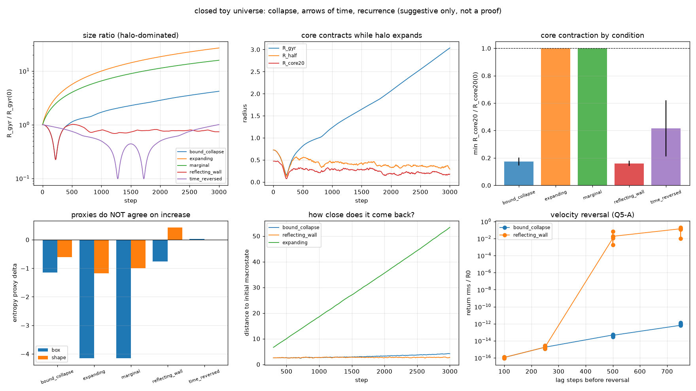

# cosmic_toy — 閉じた玩具宇宙における重力のみの崩壊・時間の矢・循環

> 本実験は 2 次元・軟化ニュートン・放射なし・有限時間の**玩具**です。得られるのは保存量・相関・再現誤差であり、宇宙論の**証明**ではありません。記述はすべて**示唆**として読んでください。

## 公開ミラーと開発正本

| 役割 | 場所 |
| :--- | :--- |
| **公開ミラー（本リポジトリ）** | [inverse-pi-optimizer/cosmic_toy/](.) — スクリプト・README・代表図のみ（巨大 CSV/JSON は除外） |
| **開発正本** | [ai-budget-meter / Labs/cosmic_toy](https://github.com/cocoa3j21/ai-budget-meter/tree/master/Labs/cosmic_toy) — フル実行ログ・全図・旧世代結果を保持 |

逆πマトリクス実験はリポジトリ直下の [`README.md`](../README.md) を参照してください。

## 概要

2 次元 Plummer 軟化付きニュートン自己重力系（散逸・放射なし）について、**leapfrog (KDK) 時間可逆積分**で次の問いを数値的に追います。

- **Q1**: ほぼ一様な系は重力だけで凝縮するか
- **Q2**: 凝縮状態は『ビッグバン直後』に似るか（エントロピー代理）
- **Q3**: 時間の矢を収縮方向に読むと何が変わるか
- **Q4**: 循環するか、一方向に終わるか
- **Q5**: 速度反転 / ラベル反転で過去に戻るか

## 現在の状態（2026-11-25）

| 項目 | 状態 |
| :--- | :--- |
| `cosmic_collapse_time_arrow.py` | 復旧済み・フルラン再実行済み（開発正本） |
| 代表図 | [`figures/cosmic_collapse_time_arrow.png`](figures/cosmic_collapse_time_arrow.png)（6 パネル要約） |
| 数値サマリ | 下記「結果の要約」（詳細 CSV/JSON はローカル再実行で生成） |



### 結果の要約（示唆のみ）

開発正本 `results_new/` の実測（N=200・3000 steps・5 シード×5 条件）に基づく。

- **Q1**: コア収縮 0.173±0.029、ハロー側は後段で最大 4.18 倍まで開く＝コア収縮とハロー膨張が同一ランに共存。
- **Q2**: エントロピー代理 3 種の向きが揃わず、『ビッグバン直後に似る』かは**本データでは裁定できない**。
- **Q3**: 時間ラベルの並べ替えは物理量を変えず、相関の見え方だけが変わる（解釈実験）。
- **Q4**: 閉箱と孤立系で最接近距離に明確差なし。膨張条件は一方向に開き続ける。
- **Q5-A**: なめらか系は丸め誤差レベルで巻き戻し；反射壁は衝突で誤差が増幅する**示唆**。
- **Q5-B**: ラベル反転で multiset は一致。 **`時空が逆方向に動く`とは主張しない。**

## 実行方法

```bash
cd cosmic_toy
pip install numpy matplotlib

# スモーク（約数秒）
python cosmic_collapse_time_arrow.py --quick

# フル（約150秒）— CSV/JSON は cosmic_toy/results_new/ に出力
python cosmic_collapse_time_arrow.py
```

巨大な成果物は `.gitignore` でリポジトリ外。再現する場合は上記をローカルで実行してください。

## 関連リンク（導線）

| 種別 | URL |
| :--- | :--- |
| **Zenn（逆πシリーズ・マトリクス実験）** | [不可解な「逆円周率ノイズ」を、局所解からAIを救うアテにする](https://zenn.dev/cocoa3j21/articles/b72a764450e23a) |
| **Zenn（rotation_minimal 系・既存記事）** | [Zenn 記事](https://zenn.dev/cocoa3j21/articles/2fc28f602b0a6c) |
| **GitHub** | [cocoa3j21/inverse-pi-optimizer](https://github.com/cocoa3j21/inverse-pi-optimizer)（本ミラー） |
| **Buy Me a Coffee** | [cocoa3j21](https://www.buymeacoffee.com/cocoa3j21) |

玩具宇宙向け Zenn は**草案済み**（開発正本: [ZENN_ARTICLE_DRAFT.md](https://github.com/cocoa3j21/ai-budget-meter/blob/master/Labs/cosmic_toy/ZENN_ARTICLE_DRAFT.md)）。Zenn 公開後は本 README の cosmic 行を記事 URL に差し替えます。

## 今後の予定

本実験は**玩具モデル・解釈実験**の**示唆**です。宇宙論や物理法則の確定とは書きません。

| # | 項目 | 状態 |
| :--- | :--- | :--- |
| 2 | `rotation_minimal` ミラー反映 | **完了** — [`../rotation_minimal/`](../rotation_minimal/) |
| 3 | Zenn 記事（cosmic） | **草案済み** — 上記 `ZENN_ARTICLE_DRAFT.md` |
| 4 | Zenn 記事（rotation） | **既存記事あり** — https://zenn.dev/cocoa3j21/articles/2fc28f602b0a6c |

継続メモ: 開発正本との差分はスクリプト SHA と代表図のみを定期同期。

## トーンポリシー

- 「証明された」「宇宙の正体が判明した」とは**書かない**。
- 玩具系・有限時間・粗視化エントロピー代理の限界を明記する。