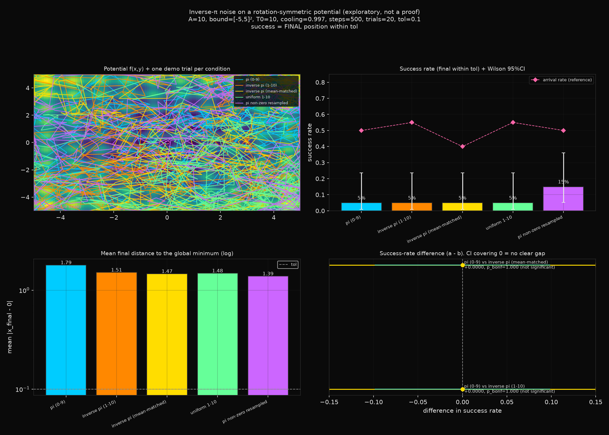

# rotation_minimal — 回転対称ポテンシャルと逆πノイズ（玩具・示唆）

> 2 次元・焼きなまし法の**解釈実験**です。最適化や物理法則の**証明**ではありません。記述はすべて**示唆**として読んでください。

## 公開ミラーと開発正本

| 役割 | 場所 |
| :--- | :--- |
| **公開ミラー（本リポジトリ）** | [inverse-pi-optimizer/rotation_minimal/](.) — スクリプト・README・代表図のみ |
| **開発正本** | [ai-budget-meter / Labs/rotation_minimal](https://github.com/cocoa3j21/ai-budget-meter/tree/master/Labs/rotation_minimal) — 旧世代図（`rotation_inverse_pi_*.png`）・再実行ログ |

マトリクス本体は [`../README.md`](../README.md) を参照してください。

## 概要

回転対称性を持つ 2D ポテンシャル上で、π / 逆π など **5 ノイズ条件**の焼きなまし法を比較します。
マトリクス実験より条件を絞ったサテライトで、「回転仮説」側の直感を数値で追うための**玩具モデル**です。

## 現在の状態（2026-11-25）

| 項目 | 状態 |
| :--- | :--- |
| `rotation_minimal.py` | pyc・既存図から**復旧推定**（数値の旧図完全一致は保証しない） |
| 代表図 | [`figures/rotation_minimal_quick.png`](figures/rotation_minimal_quick.png)（`--quick` スモーク） |



## 復旧時の推定（既存図から）

| 項目 | 推定値 |
| :--- | :--- |
| 目的関数 | `f = x²+y² + A(2−cos2πx−cos2πy)`, A=10 |
| 範囲 | `[-5,5]²`, T0=10, cooling=0.997, steps=3000, tol=0.1 |
| 試行 | 100〜1000（図ファイル名）、5 シード [42,7,13,29,101]（multiseed 図） |
| 出力レイアウト | 4 パネル（ポテンシャル+軌跡 / 成功率 / 最終距離 / 差のCI） |

詳細表は開発正本 README を参照してください。

## 実行

```bash
cd rotation_minimal
pip install numpy matplotlib

python rotation_minimal.py --quick
python rotation_minimal.py --trials 100
python rotation_minimal.py --trials 1000
python rotation_minimal.py --multiseed --trials 1000
```

### 出力先（ローカル・gitignore 対象）

| モード | results/ | figures/ |
| :--- | :--- | :--- |
| 通常 | `rotation_minimal.json`, `.csv`（集計のみ） | `rotation_minimal.png` |
| `--quick` | `rotation_minimal_quick.*` | `rotation_minimal_quick.png` |
| `--multiseed` | `rotation_minimal_multiseed.*` | `rotation_minimal_multiseed.png` |

巨大な試行ログは生成しません。ミラーに載せるのはスクリプトと代表図のみです。

## 関連リンク

| 種別 | URL |
| :--- | :--- |
| **Zenn（逆πマトリクス）** | [不可解な「逆円周率ノイズ」を、局所解からAIを救うアテにする](https://zenn.dev/cocoa3j21/articles/b72a764450e23a) |
| **Zenn（rotation_minimal・既存記事）** | [Zenn 記事](https://zenn.dev/cocoa3j21/articles/2fc28f602b0a6c) |
| **GitHub** | [cocoa3j21/inverse-pi-optimizer](https://github.com/cocoa3j21/inverse-pi-optimizer) |
| **Buy Me a Coffee** | [cocoa3j21](https://www.buymeacoffee.com/cocoa3j21) |

## トーンポリシー

- 「証明された」「逆πが最強」「物理法則の確定」とは**書かない**。
- 試行数・シードに依存する差は**示唆**として述べる。

## 今後の予定

本実験は**玩具モデル・解釈実験**の**示唆**です。最適化や物理法則の確定とは書きません。

| # | 項目 | 状態 |
| :--- | :--- | :--- |
| 2 | `rotation_minimal` ミラー反映 | **完了** — 本ディレクトリ |
| 3 | Zenn 記事（cosmic） | **草案済み** — [ZENN_ARTICLE_DRAFT.md](https://github.com/cocoa3j21/ai-budget-meter/blob/master/Labs/cosmic_toy/ZENN_ARTICLE_DRAFT.md) |
| 4 | Zenn 記事（rotation） | **既存記事あり** — https://zenn.dev/cocoa3j21/articles/2fc28f602b0a6c |